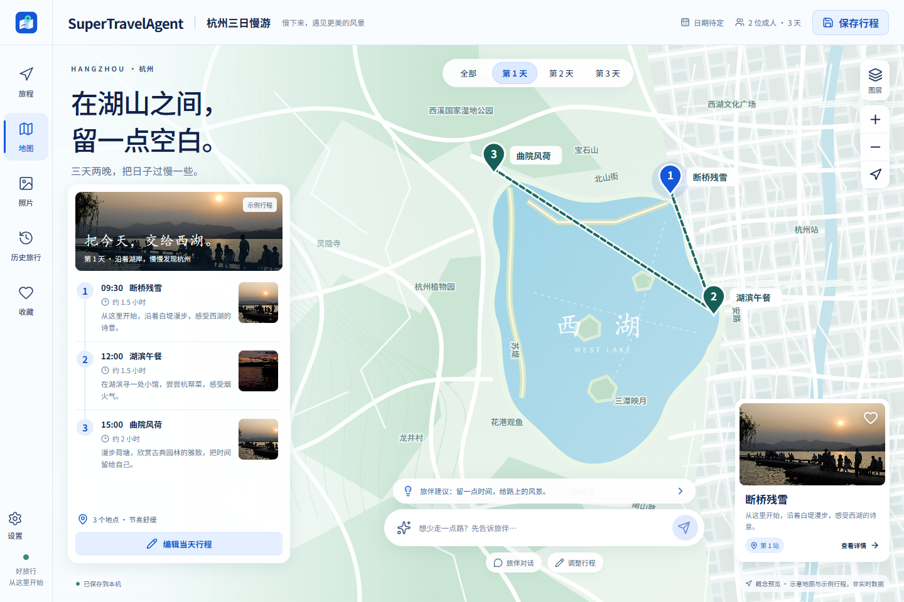

# Super-Travel

本地优先的旅行规划桌面客户端：**Tauri 2 + React + Python、本地 JSON 会话、双 Agent、三平台打包与签名更新**。[下载发行版](https://github.com/IT-coder-Yy/Super-Travel/releases/latest)。当前源码版本为 **0.1.4**，包含真实地点编辑、同日与跨日拖拽、候选池、常用旅行偏好、公交详情与出租车估算，以及支持罕字和 emoji 的 Markdown/PDF 正式行程导出。

界面按 [原项目 README 的 C1 Glacier White Preview](https://github.com/IT-coder-Yy/SuperTravel-Agent#preview) 重新实现。主分支支持真实地点行程生成、地图展示、草稿修改和本地保存；新会话从空白开始，旧示例会话仍明确标注。

0.1.3 已完成 Windows x64、macOS Apple Silicon/Intel、Linux x64 原生业务界面验收及 0.1.2 → 0.1.3 升级验证；全部 12 项公开发布资产已下载并核验。后续源码的构建状态以对应 PR 的 GitHub Actions 检查为准。



截图来自本工程实际运行页面。照片：[DXR 的桥畔日落](https://commons.wikimedia.org/wiki/File:Sunset_over_the_Zigzag_Bridge,_West_Lake,_Hangzhou_20090909_1.jpg)、[Tyler Valentine 的西湖暮色](https://commons.wikimedia.org/wiki/File:West_lake_twilight.jpg)，按 CC BY-SA 4.0 裁切展示；界面内也保留来源说明。

## 当前边界

- 冰川白地图工作台、真实行程生成、动态日期与地点切换、草稿编辑及应用、上一版恢复、聊天记录、历史与设置。
- 搜索真实地点，新增、替换、删除和跨日移动活动，候选池加入正式行程；修改后重新检查路线与时间。
- 本地保存预算、节奏、饮食与同行偏好，用户本次明确要求优先。
- Markdown/PDF 只导出已确认的正式行程；未应用草稿不混入导出。
- 已选 C2 地图定位图标，统一用于客户端、导航与开场；约 3 秒的点云轨道开场按任意键跳过，并适配减少动态效果设置。
- Python 只监听本机动态端口，使用启动时生成的随机访问令牌；退出桌面客户端时结束服务。
- 会话按文件保存，默认在操作系统用户数据目录；可选择其他目录，下一次启动生效，原文件不会自动搬动或删除。
- 一份会话对应一个 JSON，保存采用临时文件、校验、备份与原子替换，修订冲突不会直接覆盖。
- 损坏会话在设置中可扫描有效备份，确认后恢复；原件另存到数据目录的 `recovered-originals/`，其余历史仍可使用。
- 双 Agent 使用显式 Python 流程；按会话记录计划与进度，支持取消和重启中断，旧结果不能覆盖新任务。模型 Key 通过系统凭据库保存，浏览器开发模式仅放后端内存。
- 用户只填写模型 URL、模型名和 Key。当前版本先用于本机开发，桌面默认连接 `http://127.0.0.1:8080` 的工具服务，需开发者另行启动；设置中可修改服务地址。高德、百度、Tavily、Serper 和小红书公开搜索的凭据由开发者保存在工具服务端，不进入安装包，客户端不填写工具 Key。浏览器开发模式仍兼容直接连接外部服务。
- Windows、macOS、Linux 分别在对应的 GitHub Actions 环境构建。构建和原生升级检查结果可在 GitHub Actions 查看。

## 本地开发

需要 Node.js 22.12+、Python 3.13 和 [uv](https://docs.astral.sh/uv/getting-started/installation/)。桌面开发还需要 Rust 1.90+ 与 [Tauri 平台依赖](https://v2.tauri.app/start/prerequisites/)。

Linux 运行与界面验收需有中文字体；精简 Ubuntu/Debian 环境可安装 `fonts-noto-cjk`。

```powershell
npm ci
uv sync --project server --locked
npm run dev
```

根目录的 npm workspace 管理 `client/`，整个仓库共用一份 `package-lock.json`。后端依赖仅维护 `server/pyproject.toml` 与 `server/uv.lock`；运行 `uv add --project server 包名` 添加运行依赖，使用 `--dev` 添加测试或构建依赖，再提交更新后的两个文件。`uv sync --project server --locked` 会校验锁文件，不会自行升级版本。也可以进入 `server/` 后运行 `uv sync --locked`、`uv run pytest`。

浏览器打开 `http://127.0.0.1:1420`。此命令同时启动独立 Python 与 Vite，开发会话保存在 `.local/dev-data`，不接触旧项目的数据。单独执行 `npm run web` 只预览前端，不能保存会话；浏览器模式不安装桌面更新。

桌面开发：

```powershell
npm run desktop:dev
```

桌面壳负责启动自己的 Python，不要把 `npm run dev` 与 `desktop:dev` 同时运行。可用 `STA_PYTHON` 显式指定解释器；优先使用本工程的 `server/.venv`。

桌面使用工具前，开发者需在另一个终端启动工具服务。按 [服务环境模板](server/.env.example) 准备自己的 `.local/tools.env`，仅填写四项工具凭据，然后执行：

```powershell
$env:STA_DEV_ENV_FILE = ".local/tools.env"
npm run tools:dev
```

服务默认监听 `127.0.0.1:8080`；可用 `STA_TOOLS_PORT` 改端口，并在客户端设置中填写对应地址。模型 Key 留在客户端模型设置中，不放进工具服务环境文件。当前没有已上线的公共工具服务，安装客户端不会自动启动这项服务；详细说明见 [后端说明](server/README.md)。

## PDF 资源

字体、表情资源的准备、离线导出与许可证见[后端说明](server/README.md)。首次开发和正式构建会检查资源；也可手动执行 `npm run assets:prepare`。

## 检查与打包

```powershell
npm run build
npm run test:assets
npm run test:backend
npm run test:platform
npm run test:ui
npm run desktop:build
```

界面测试自行启动隔离服务，无需预先运行开发服务器；本机默认使用已安装的 Edge，显式联网照片检查仍会访问 Wikimedia。Python 使用 PyInstaller 打包为 sidecar；每个操作系统与 CPU 架构在对应环境构建，不把 Windows 二进制复制进 macOS/Linux 安装包。发布端必须保存包签名私钥，客户端只内置公钥。

业务回归使用带来源说明的固定测试照片，避免外部图片连接失败阻断存储和编辑测试。单独验证真实照片可设置 `STA_LIVE_PHOTOS=1` 并运行 `npm run test:ui -- --grep "真实 Wikimedia"`；这项检查失败会如实报错，不回退测试照片。

## 更新与发布

公开仓库：<https://github.com/IT-coder-Yy/Super-Travel>。

仓库已更名为 Super-Travel，更新验证脚本兼容历史更新清单保留的旧仓库地址。

- GitHub Actions 构建 Windows x64、macOS arm64/x64、Linux x64。
- 正式发布必须配置 `TAURI_SIGNING_PRIVATE_KEY` Secret，以及 `STA_UPDATER_PUBLIC_KEY`、`STA_UPDATE_ENDPOINT` 变量。`STA_SHARED_TOOLS_URL` 可选，默认 `http://127.0.0.1:8080`；本机模式的 tag 构建不要求 CI 运行工具服务。若显式配置 HTTPS 服务，发布前仍检查工具目录与凭据配置状态。仅允许 HTTPS 或回环 HTTP 地址，不允许 URL 凭据、查询参数和片段；四项工具凭据始终只放在服务运行环境中。
- 私钥不写入源码或客户端；本地生成的私钥仅存放在被 Git 忽略的 `.local/keys/`，请独立备份。丢失私钥会影响已安装版本的后续更新。
- 更新流程：检查新版本 → 用户同意 → 保存当前会话/草稿 → 下载与验签 → 关闭 Python → 安装并重启。
- 下载可尝试公开 GitHub 镜像，失败回 GitHub 原始资产；镜像与原始下载都必须经过同一公钥验签。镜像不用于发送模型 Key 或本地服务令牌。
- 未配置更新源时界面明确显示未配置，不冒充“已是最新”。

macOS 首批包采用 ad-hoc 签名，未进行 Apple 公证；首次启动可能需要系统允许。Tauri 更新包签名与 Apple 签名是两套机制，实际运行和升级结果以验证记录为准。

## 目录

后端开发、资源与工具协议见[server/README.md](server/README.md)；客户端开发、测试照片署名与原生验收见[client/README.md](client/README.md)。

| 目录 | 职责 |
| --- | --- |
| `client/src/` | React 工作台、API 与桌面桥接 |
| `client/tests/` | 浏览器端到端测试、原生测试与夹具 |
| `server/src/` | Python 服务与资源；逻辑包 `supertravel_server` 直接映射到此目录 |
| `server/tests/` | 后端测试 |
| `server/pyproject.toml`、`server/uv.lock` | Python 依赖声明和锁定版本 |
| `server/.env.example` | 本机工具凭据模板 |
| `client/src-tauri/` | Rust 桌面生命周期、更新、用户数据目录 |
| `client/scripts/`、`server/scripts/` | 各端专用构建、资源准备与检查脚本 |
| `scripts/` | 跨端启动、打包编排、版本与发布检查 |
| `.github/workflows/` | 三平台构建和发布流水线 |
| `.local/` | 仅本机的开发数据、密钥、临时工具；不入 Git |

真实行程生成、地图展示、修改和保存已完成本机联调及三平台原生业务验收。当前版本默认使用本机工具服务，尚未部署公共云服务；高德真实步行算路通过，当前开发凭据的地点检索仍受额度限制。
