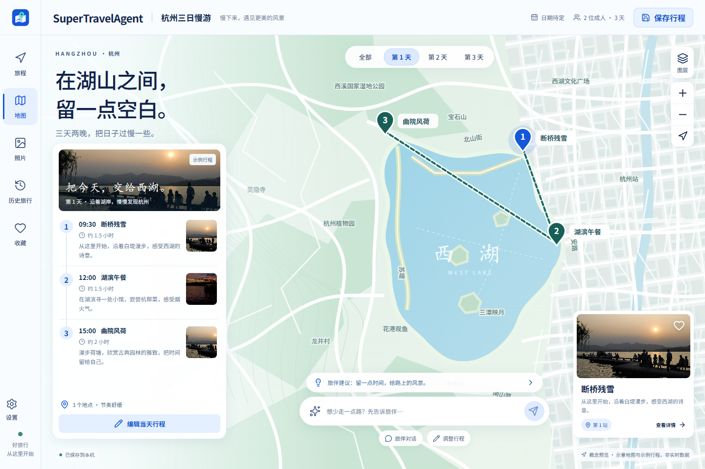

# SuperTravelAgent

本地优先的旅行规划桌面客户端：**Tauri 2 + React + Python、本地 JSON 会话、双 Agent、三平台打包与签名更新**。已发布 0.1.1 桌面骨架，主分支为 0.1.2 开发版；验收状态见 [M1](docs/VALIDATION.md)、[M2](docs/M2.md) 与 [真实行程闭环](docs/M3.md)。

界面按 [原项目 README 的 C1 Glacier White Preview](https://github.com/IT-coder-Yy/SuperTravel-Agent#preview) 重新实现。主分支支持真实地点行程生成、地图展示、草稿修改和本地保存；新会话从空白开始，旧示例会话仍明确标注。



截图来自本工程实际运行页面。照片：[DXR 的桥畔日落](https://commons.wikimedia.org/wiki/File:Sunset_over_the_Zigzag_Bridge,_West_Lake,_Hangzhou_20090909_1.jpg)、[Tyler Valentine 的西湖暮色](https://commons.wikimedia.org/wiki/File:West_lake_twilight.jpg)，按 CC BY-SA 4.0 裁切展示；界面内也保留来源说明。

## 当前边界

- 冰川白地图工作台、真实行程生成、动态日期与地点切换、草稿编辑及应用、上一版恢复、聊天记录、历史与设置。
- 已选 C2 地图定位图标，统一用于客户端、导航与开场；约 3 秒的点云轨道开场按任意键跳过，并适配减少动态效果设置。
- Python 只监听本机动态端口，使用启动时生成的随机访问令牌；退出桌面客户端时结束服务。
- 会话按文件保存，默认在操作系统用户数据目录；可选择其他目录，下一次启动生效，原文件不会自动搬动或删除。
- 一份会话对应一个 JSON，保存采用临时文件、校验、备份与原子替换，修订冲突不会直接覆盖。
- 损坏会话在设置中可扫描有效备份，确认后恢复；原件另存到数据目录的 `recovered-originals/`，其余历史仍可使用。
- 双 Agent 使用显式 Python 流程；按会话记录计划与进度，支持取消和重启中断，旧结果不能覆盖新任务。模型 Key 通过系统凭据库保存，浏览器开发模式仅放后端内存。
- 用户只填写模型 URL、模型名和 Key；高德、百度、Tavily、Serper、小红书公开搜索由开发者统一配置，直接使用现有外部服务，无需本机独立网关。接入方式和发布边界见 [外部服务](docs/EXTERNAL_SERVICES.md)。
- Windows、macOS、Linux 分别在对应的 GitHub Actions 环境构建。安装包有无成功产出、原生升级是否实际验证，见 [验证记录](docs/VALIDATION.md)。

## 本地开发

需要 Node.js 22.12+ 和 Python 3.13。桌面开发还需要 Rust 1.90+ 与 [Tauri 平台依赖](https://v2.tauri.app/start/prerequisites/)。

```powershell
npm ci
python -m venv backend/.venv
# Windows
backend/.venv/Scripts/python -m pip install -r backend/requirements-dev.txt
# macOS / Linux 将上一行的 Python 路径替换为 backend/.venv/bin/python
npm run dev
```

浏览器打开 `http://127.0.0.1:1420`。此命令同时启动独立 Python 与 Vite，开发会话保存在 `.local/dev-data`，不接触旧项目的数据。单独执行 `npm run web` 只预览前端，不能保存会话；浏览器模式不安装桌面更新。

桌面开发：

```powershell
npm run desktop:dev
```

桌面壳负责启动自己的 Python，不要把 `npm run dev` 与 `desktop:dev` 同时运行。可用 `STA_PYTHON` 显式指定解释器；优先使用本工程的 `backend/.venv`。

## 检查与打包

```powershell
npm run build
backend/.venv/Scripts/python -m pytest backend/tests -q
backend/.venv/Scripts/python scripts/test-platform.py
npm run test:ui
npm run desktop:build
```

工作台与 Agent 界面测试自行启动隔离服务；开场测试和显式联网照片检查使用 `npm run dev` 的页面，本机默认使用已安装的 Edge。Python 使用 PyInstaller 打包为 sidecar；每个操作系统与 CPU 架构在对应环境构建，不把 Windows 二进制复制进 macOS/Linux 安装包。发布端必须保存包签名私钥，客户端只内置公钥。

业务回归使用带来源说明的固定测试照片，避免外部图片连接失败阻断存储和编辑测试。单独验证真实照片可设置 `STA_LIVE_PHOTOS=1` 并运行 `npx playwright test -g "真实 Wikimedia"`；这项检查失败会如实报错，不回退测试照片。

## 更新与发布

公开仓库：<https://github.com/IT-coder-Yy/SuperTravelAgent>。

- GitHub Actions 构建 Windows x64、macOS arm64/x64、Linux x64。
- 正式发布必须配置 `TAURI_SIGNING_PRIVATE_KEY` Secret，以及 `STA_UPDATER_PUBLIC_KEY`、`STA_UPDATE_ENDPOINT` 变量。
- 私钥不写入源码或客户端；本地生成的私钥仅存放在被 Git 忽略的 `.local/keys/`，请独立备份。丢失私钥会影响已安装版本的后续更新。
- 更新流程：检查新版本 → 用户同意 → 保存当前会话/草稿 → 下载与验签 → 关闭 Python → 安装并重启。
- 下载可尝试公开 GitHub 镜像，失败回 GitHub 原始资产；镜像与原始下载都必须经过同一公钥验签。镜像不用于发送模型 Key 或本地服务令牌。
- 未配置更新源时界面明确显示未配置，不冒充“已是最新”。

macOS 首批包采用 ad-hoc 签名，未进行 Apple 公证；首次启动可能需要系统允许。Tauri 更新包签名与 Apple 签名是两套机制，实际运行和升级结果以验证记录为准。

## 目录

| 目录 | 职责 |
| --- | --- |
| `src/` | React 工作台、API 与桌面桥接 |
| `backend/` | Python 服务、JSON 存储与测试 |
| `src-tauri/` | Rust 桌面生命周期、更新、用户数据目录 |
| `scripts/` | 开发、sidecar 构建、发布清单与检查脚本 |
| `.github/workflows/` | 三平台构建和发布流水线 |
| `.local/` | 仅本机的开发数据、密钥、临时工具；不入 Git |

真实行程生成、地图展示、修改和保存已完成本机联调，验证范围见 [M3](docs/M3.md)。工具查询仍受服务额度和网络影响；本机通过不等于正式安装包已完成全部验收，共享工具凭据的正式分发方案仍待落实。
