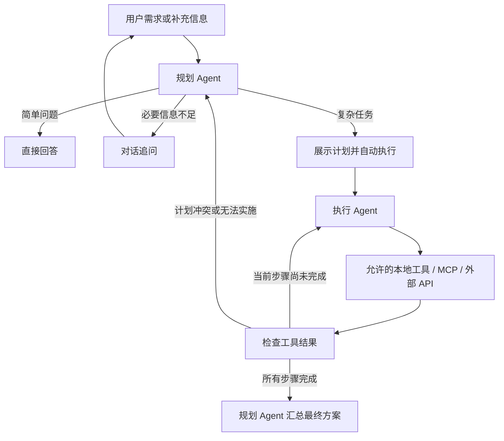

# 双层 ReAct：规划与执行

这里的 **ReAct** 是 Agent 的“观察 → 决策 → 行动 → 再观察”循环，与界面使用的 React 无关。沿用 `backend/agents.py` 的显式 Python 流程、同一模型连接和两个角色，不引入新的 Agent 框架。

## 规划循环

- `route_request` 选择直答、对话追问、计划或进度查询。只追问完成请求必需的信息；用户补充后重新决策。
- 计划展示后自动交给执行 Agent；普通聊天和查询进度不打断正在执行的任务。
- 超过 3 天的计划按每 1～2 天分组，最后整合提交；地点候选给模型时仅保留 ID、名称、地址和供应商，坐标证据留在代码侧，减少重复上下文。
- 执行反馈与已完成结果进入下一次规划。最多修改计划两轮，缺信息时回到对话等待用户，不无限循环。
- 执行成功后由规划 Agent 做一次最终汇总。旅行汇总仅收到已校验的结构化行程，不依赖内部步骤文字；首次生成与修改草稿分别表述。

## 执行循环

- 每步按“调用工具 → 观察返回 → 决定后续调用”推进，只能调用本次提供且通过参数校验的工具。
- `search_trip_places` 查询真实地点；`query_trip_route` 只接收地点 ID 和交通方式，坐标和供应商调用由代码处理。路线查不到保留未知；已知接驳时间不足时不能提交。
- `report_plan_issue` 是本地反馈动作：发现计划缺条件、冲突或无法实施时，给规划 Agent 一条简洁原因，不自行扩大任务范围。
- 最后一步使用 `submit_trip` 提交结构化行程；普通文字不能替代有效行程。地图、检索等官方 MCP/API 仍通过现有工具适配器访问，不开放任意文件或 shell 操作。

## 终止、保存和失败

- 保留原有单会话单执行、取消、任务 ID 校验和迟到结果隔离；取消后的工具或模型结果不能写回。
- 临时工具错误最多额外重试一次。默认普通任务最多 12 次工具调用；旅行按天数分配 `max(12, 天数 × 7 + 8)`，最高 64 次。显式配置的调用上限始终优先，重试也计数。
- 最终汇总不可用时保留已完成结果，显示降级提示，不重新消耗工具额度；汇总期间仍可以取消。
- 修改只生成草稿，仍须用户点击应用；JSON 原子保存、备份与上一版恢复保持原流程。
- 界面展示计划、工具状态、问题和结果，不展示模型内部推理过程。当前澄清使用对话，未增加卡片系统。

回归入口：`backend/tests/test_agents.py`、`backend/tests/test_agent_api.py` 和 `backend/tests/test_trips.py`；覆盖双循环、失败反馈、有限重规划、汇总故障、取消与保存边界。此文档描述实现行为，不替代真实模型和安装包验收记录。
